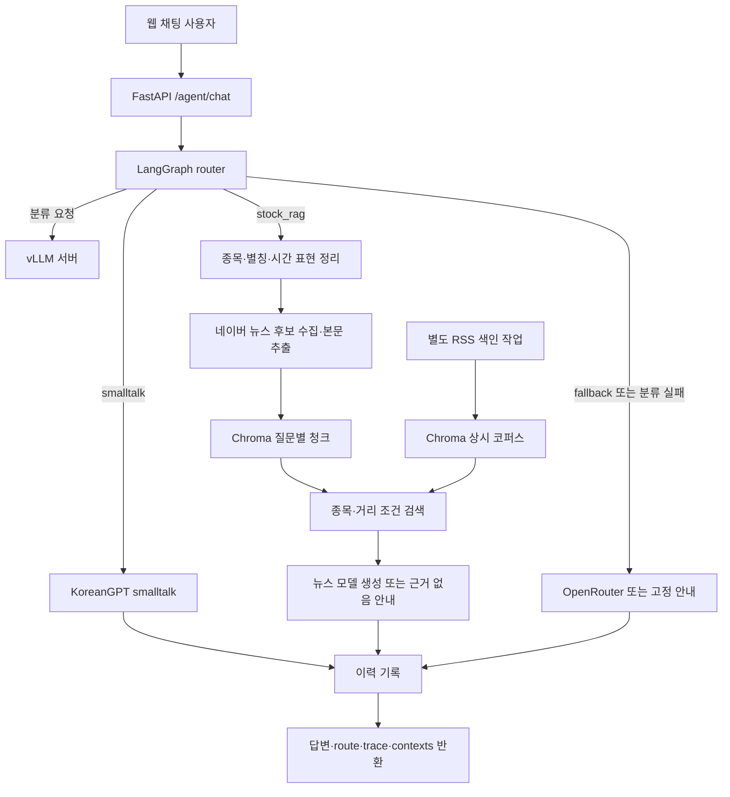

# 한국어 Mini-GPT 기반 주식 뉴스 챗봇

SentencePiece와 약 42M 파라미터의 Decoder-only Transformer를 직접 구현하고, 한국어 대화·주식 뉴스 응답 학습부터 뉴스 수집, RAG, FastAPI, 배포까지 연결한 개인 프로젝트입니다.

최근 작업에서는 중복 모델 적재, 뉴스 필터, 세션 상태를 개선하고 Colab에서 멀티턴 fine-tuning과 학습 전후 평가를 수행했습니다. **검증 loss는 감소했지만 자체 모델의 문맥 참조 개선은 확인하지 못해 새 체크포인트의 서빙 교체를 보류했습니다.**

[모델 저장소](https://huggingface.co/Dongju-00/eric-chatagent) · [뉴스 학습 노트북](notebooks/colab/eric_news_multiturn_colab.ipynb) · [스몰톡 학습 노트북](notebooks/colab/eric_smalltalk_multiturn_colab.ipynb)

## 구현 범위

| 영역 | 구현 |
|---|---|
| 모델 | PyTorch KoreanGPT, SentencePiece, 사전학습·태스크별 fine-tuning |
| 검색 | 네이버 뉴스 수집, 종목·날짜 필터, 자체 임베더와 Chroma 검색, RSS 코퍼스 |
| 대화 흐름 | LangGraph의 `smalltalk` / `stock_rag` / `fallback` 분기 |
| 세션 | `thread_id`별 이력, 현재 턴의 trace·검색 근거 초기화 |
| 외부 모델 | vLLM 질문 분류, OpenRouter fallback 자유 답변 |
| 평가 | 검색·생성 진단, 데이터 감사, 동일 평가셋의 학습 전후 비교 |
| 서비스 | FastAPI, 웹 채팅 UI, Docker, nginx, GitHub Actions·EC2 배포 |

## 실행 구조



모델과 스토어는 FastAPI `lifespan`의 `build_resources()`에서 프로세스 시작 시 생성하고 그래프에 주입합니다. 모듈 import만으로 가중치나 Chroma 클라이언트를 생성하지 않습니다. 실제 리소스 구성은 임베더 1벌, 생성 모델 2벌, Chroma 클라이언트 1개입니다.

### 뉴스 수집·검색

- 기본 최근 기준은 5일입니다. 종목 사전 299종과 별칭을 사용하고 제목 일치를 우선하며, 필터 결과가 비면 무관한 원본 기사로 되돌아가지 않습니다.
- 기본 네이버 후보 풀은 요청 기사 수의 8배입니다. 서빙에서는 본문 추출 대상 최대 3건, 최대 10개 스레드와 5초 다운로드 타임아웃을 사용합니다.
- 서빙 청크는 358자, 중첩 50자입니다. 그래프는 거리 상한 `1.25`로 최대 2개 문서를 선택합니다.
- 검색 범위는 이번 `question_id`의 청크와 대상 종목의 RSS 코퍼스입니다. 종목별 수집 결과 캐시로 네이버 요청을 건너뛰는 분기는 구현돼 있지 않습니다.
- RSS 색인·질문 청크 정리는 별도 스크립트로 실행합니다. 기본 TTL은 6시간이며, 주기 실행은 별도로 설정해야 합니다.

### 세션과 모델별 이력 활용

`MemorySaver`가 `thread_id`별 상태를 메모리에 유지합니다. 매 턴 `trace`, `question_id`, `contexts`, `retrieved_docs`를 초기화하고, 대화 이력은 `history`에 별도로 저장합니다. 기본 이력 예산은 120토큰이며 최신 턴은 예산을 넘더라도 보존합니다. 서버를 재시작하면 메모리의 세션은 유지되지 않습니다.

현재 fallback은 이력을 OpenRouter 메시지에 전달합니다. 자체 스몰톡 경로는 현재 질문만 입력하고, 뉴스 체인은 빈 history 기본값을 사용합니다. **이력을 저장하는 서빙 기능과 자체 모델이 이전 발화를 이해하는 능력은 별개입니다.**

`VLLM_BASE_URL` 미설정·분류 실패 시 fallback으로 이동합니다. OpenRouter 키가 있으면 외부 모델이 답하고, 키가 없거나 호출이 실패하면 고정 안내 문구를 반환합니다. 이 경로의 외부 모델 응답도 사실 정확성을 보장하지 않습니다.

## 모델과 학습

| 항목 | 값 |
|---|---|
| 구조 | Decoder-only Transformer, 8블록·hidden 512·attention head 8개 |
| 파라미터 | 41,816,704개, 약 42M |
| 토크나이저 | SentencePiece, 어휘 16,000 |
| 모델 문맥 상한 | 384토큰 |
| 임베더 | `KoreanGPT.pt`의 hidden state 평균 사용 |
| 서빙 스몰톡 | `KoreanGPT_smalltalk.pt` |
| 서빙 뉴스 | `KoreanGPT_news_v2.pt` |

위키 기반 텍스트 사전학습 후 스몰톡·뉴스 응답 체크포인트를 분리했습니다. 생성용 가중치를 임베더로 사용하며 별도의 대조 학습을 적용한 검색 모델은 아닙니다. 가중치·토크나이저와 학습 원본은 소스 저장소에 포함하지 않습니다.

### 멀티턴 fine-tuning 데이터

| 구분 | 구성·분할 |
|---|---|
| 스몰톡 원본 | 유효 SNS 18,040세션 + 합성 전이 400세션 |
| 스몰톡 샘플 | train 25,651 / val 1,314, train 멀티턴 비율 99.98% |
| 뉴스 원본 | 실제 기사 600건 중 추출 품질이 낮은 13건 제외, 최종 587기사 |
| 뉴스 QA | 기사당 4턴, 총 2,348턴; train 528기사 / val 59기사 |
| 누수 방지 | 원본 세션·기사·합성 템플릿별 분리 후 윈도우 생성, 원본 그룹 중복 0건 |

뉴스 질문은 후속 질문 템플릿, 답변은 원문 발췌와 정보 없음 응답으로 구성했습니다. 정보 없음 응답은 약 28%입니다. 합성 전이 400세션은 집필 흐름 20종과 기업명 20종의 조합입니다. 두 데이터 모두 별도의 사람 검수 독립 정답셋을 대체하지 않습니다.

QA 쌍을 중간에 자르지 않고 인접 윈도우에 QA 1쌍을 중첩했습니다. 스몰톡 샘플 길이는 256토큰, 뉴스는 384토큰이며 모델 자체의 문맥 상한·어휘 수는 유지했습니다. 중첩 때문에 스몰톡 전체 노출 토큰은 기존 약 480만에서 512만으로 증가했습니다.

### 실제 Colab 학습 설정

| 설정 | 스몰톡 | 뉴스 |
|---|---|---|
| 학습 방식 | 전체 파라미터 SFT | 전체 파라미터 SFT |
| 샘플 길이 / 배치 | 256 / 32 | 384 / 16 |
| learning rate | `2e-5` | `1e-5` |
| optimizer | AdamW | AdamW |
| 완료 에폭 / optimizer step | 2 / 1,604 | 2 / 66 |

질문·기사·패딩의 label을 `-100`으로 마스킹해 답변만 감독하고, causal shift를 한 번 적용합니다. 동적 패딩, warm-up 5%, cosine decay, weight decay 0.01, gradient clipping 1.0을 사용했습니다. 최대 2에폭·미개선 1회 조기 종료 기준이며 실제 두 실행에서는 조기 종료가 발생하지 않았습니다. GPU는 A100-SXM4-40GB였습니다.

### 학습 전후 결과 — 2026-10-24 실행

원본과 best 체크포인트를 같은 케이스·생성 설정·평가 프로토콜로 비교했습니다. 고정 케이스는 모델별 38개로 단일턴 16개, held-out 멀티턴 16개, 통제 참조 6개(3쌍)입니다.

| 지표 | 뉴스 전 → 후 | 스몰톡 전 → 후 |
|---|---|---|
| 전체 val 답변 NLL | 3.29238 → 1.51870 | 7.72973 → 3.55619 |
| 전체 val perplexity | 26.9068 → 4.5663 | 2274.9795 → 35.0295 |
| 통제 참조 대상 일치 | 0/6 → 0/6 | 0/6 → 0/6 |
| 통제 대조쌍 전체 일치 | 0/3 → 0/3 | 0/3 → 0/3 |
| 멀티턴 history gain NLL | 0.06846 → 0.05544 | 0.69055 → 0.26298 |
| 반복 4-gram 발생 답변 | 0/38 → 5/38 | 0/38 → 0/38 |

history gain은 `이력 제거 NLL − 이력 포함 NLL`입니다. 양수면 이력이 정답 likelihood에 도움을 줬다는 뜻이며 이번에는 두 모델 모두 값이 감소했습니다.

정답 앞 토큰을 제공하는 teacher-forcing loss와 자유 생성의 참조 능력은 다릅니다. 스몰톡은 앞에서 수영했다고 말한 뒤 활동을 물어도 이를 회수하지 못했고, 뉴스는 근거 밖 내용과 반복을 생성했습니다. 제한된 6케이스를 전체 멀티턴 정확도로 일반화하지 않습니다. 여러 설정을 함께 변경했으므로 256토큰 윈도우의 독립 효과도 분리하지 못했습니다. 추가 학습 없이 결과를 보존했고 새 가중치는 서빙에 채택하지 않았습니다.

## 서빙·검색 개선 측정

| 측정 항목 | 변경 전 → 후 | 범위 |
|---|---|---|
| import 시 가중치 적재 | 4회 → 0회 | 실제 자원 생성 시 모델 3벌 적재 |
| import 시 Chroma 생성 | 2개 → 0개 | 실제 자원 생성 시 1개 |
| 가중치 텐서 합계 | 669.1 → 501.8MB | 중복 167.3MB 제거, RSS 절감률 아님 |
| 종목 식별 | 9/10 → 10/10 | 고정 10질문 라이브 표본 |
| 검색 청크의 종목명 포함 | 13/20 → 17/20 | 의미 관련성의 보조 지표 |
| 기사 최대 경과 | 19일 → 4일 | 최근 기준·RSS 등 함께 변경 |
| 수집 중앙값 | 1.343 → 0.845초 | 기사·네트워크가 고정되지 않은 관찰값 |

별도 후보 풀 3배/8배 비교에서는 빈 문맥 질문이 1/10에서 0/10으로 줄었지만 종목명 포함률은 17/18에서 17/20으로 낮아졌습니다. 관련성과 응답 범위의 상충 관계를 함께 기록했습니다.

기존 5질문의 생성 진단에서는 자체 모델의 규칙 통과가 0/5, Gemini 비교가 5/5였습니다. 두 기록은 검색 문맥·실행 ID가 달라 동일 컨텍스트의 통제 비교가 아닙니다. 어휘 중복률을 사실 정확도나 환각률로 해석하거나, 이 결과만으로 모델 규모가 원인이라고 단정하지 않습니다.

## 로컬 실행

Python 3.12 이상이 필요하며 현재 CI·Docker는 Python 3.14를 사용합니다. 의존성의 기준은 `pyproject.toml`과 `uv.lock`입니다.

```bash
uv sync --locked
cp .env.example .env
```

`.env`에 실제 사용할 서비스의 키와 주소를 입력합니다.

| 환경변수 | 용도 |
|---|---|
| `NAVER_CLIENT_ID`, `NAVER_CLIENT_SECRET` | 뉴스 수집 |
| `VLLM_BASE_URL`, `VLLM_API_KEY` | Qwen 라우터의 호환 API 주소·키 |
| `ERIC_CHATAGENT_OPENROUTER_KEY` | 선택: fallback 자유 답변 |
| `ERIC_CHATAGENT_OPENROUTER_MODEL` | 선택: 사용할 모델 ID. 코드 기본값을 쓰려면 빈 값 대신 항목을 생략 |
| `GOOGLE_API_KEY` | 선택: Gemini 검색 품질 평가·비교 |
| `LANGSMITH_TRACING`, `LANGSMITH_API_KEY`, `LANGSMITH_PROJECT` | 선택: 추적 |
| `ERIC_NEWS_CUTOFF_DAYS` | 최근 기사 기준, 기본 5일 |
| `ERIC_QUESTION_CHUNK_TTL_HOURS` | RSS 색인 스크립트의 질문 청크 TTL, 기본 6시간 |
| `ERIC_HISTORY_MAX_TOKENS` | 이력 예산, 기본 120토큰, 최신 턴 예외 |

라우터가 정상 동작하려면 `Qwen/Qwen2.5-1.5B-Instruct`를 제공하는 vLLM 엔드포인트가 필요합니다. vLLM은 앱의 CPU 의존성과 별도 환경에서 운영합니다. 라우터가 없으면 모든 질문은 fallback 경로로 이동합니다.

### 모델 파일 준비

현재 Dockerfile과 같은 방식으로 Hugging Face 저장소에서 모델 파일을 내려받습니다.

```bash
uv run python -c "from huggingface_hub import snapshot_download; snapshot_download('Dongju-00/eric-chatagent', local_dir='.')"
uv run python main.py
```

기본 위치는 `src/model/data/sp_korean.model`과 `src/model/checkpoints/`의 세 가중치 파일입니다. UI는 `http://localhost:8000`, API 문서는 `http://localhost:8000/docs`입니다.

경로는 [paths.py](src/model/paths.py)에서 해석합니다. 저장소 밖의 자산을 사용할 때는 다음 값을 지정할 수 있습니다.

| 변수 | 기본값 |
|---|---|
| `ERIC_PROJECT_ROOT` | `pyproject.toml`이 있는 프로젝트 |
| `ERIC_MODEL_ROOT` | `<project>/src/model` |
| `ERIC_DATA_DIR` | `<model>/data` |
| `ERIC_CHECKPOINT_DIR` | `<model>/checkpoints` |
| `ERIC_CHROMA_PATH` | `<project>/storage/chroma` |
| `ERIC_SP_PREFIX` | `<data>/sp_korean`, 확장자 없는 prefix |

### API

| 엔드포인트 | 동작 |
|---|---|
| `POST /agent/chat` | 질문 처리와 세션 ID 반환 |
| `GET /health` | 프로세스·그래프 준비 상태 |
| `GET /` | 채팅 UI |

```bash
curl -X POST http://localhost:8000/agent/chat \
  -H 'Content-Type: application/json' \
  -d '{"question":"삼성전자 주가 알려줘","thread_id":"session-example"}'
```

응답에는 `question`, `answer`, `route`, `trace`, `contexts`, `question_id`, `thread_id`가 포함됩니다. 같은 `thread_id`를 재사용하면 세션 상태가 이어지고, 생략하면 서버가 새 ID를 발급합니다. 주식 경로의 trace는 `router_node → rewrite_query_node → search_news_node → retrieve_news_node → generate_node → record_history_node`입니다.

## Colab 학습과 기록

- [뉴스 멀티턴 노트북](notebooks/colab/eric_news_multiturn_colab.ipynb)
- [스몰톡 멀티턴 노트북](notebooks/colab/eric_smalltalk_multiturn_colab.ipynb)

노트북은 준비된 데이터 ZIP·토크나이저·초기 가중치를 검증하고, Drive의 `eric-chatagent/models/<실행별 폴더>/`에 best와 재개 상태를 저장합니다. 데이터 ZIP은 Drive의 프로젝트 루트 또는 `data/`에서 찾고 없으면 업로드를 요청합니다. 데이터 원본·ZIP은 별도로 준비해야 하며 공개 코드만으로 학습 데이터를 자동 확보하지는 않습니다.

원본 검증·분할·ZIP 생성은 [prepare_colab_finetune.py](src/model/scripts/prepare_colab_finetune.py), 노트북 생성은 [build_colab_notebooks.py](src/model/scripts/build_colab_notebooks.py)가 담당합니다. 답변 마스킹·배치는 [finetune_data.py](src/model/train/finetune_data.py), 전후 평가는 [finetune_metrics.py](src/model/train/finetune_metrics.py)에 구현했습니다.

실행별 산출물에는 `config.json`, `dataset_audit.json`, `evaluation_cases.json`, `before_metrics.json`, `after_metrics.json`, `comparison.json/.csv`, `manual_review.csv`, `training_summary.json`, `training_history.json`, best 가중치와 `last.resume.pt`가 있습니다. 데이터·평가 프로토콜·체크포인트 해시로 결과의 대응을 확인합니다. 개별 대화·원본 측정 파일·모델 바이너리는 소스와 별도로 보관합니다.

## 검증과 운영 스크립트

```bash
# 로컬 테스트: 세션 테스트에 토크나이저가 필요하며,
# 실제 리소스 적재 검증에는 가중치도 필요합니다.
PYTHONPATH=src uv run --locked python -m unittest discover -s tests

# 생성·검색 진단: 실제 API 호출과 스토어 색인이 발생합니다.
PYTHONPATH=src uv run --locked python -m model.rag.evaluate_rag

# RSS 색인과 만료 질문 청크 정리: 스토어를 변경합니다.
PYTHONPATH=src uv run --locked python src/model/scripts/ingest_rss.py
```

이번 변경을 검증한 로컬 환경에서 테스트 95개가 통과했습니다. [CI 워크플로](.github/workflows/ci.yml)의 현재 `test` job은 `uv sync --locked` 설치 검증이며, 위 단위 테스트 전체를 자동 실행하는 설정은 아직 포함하지 않습니다.

[measure_retrieval.py](measurements/measure_retrieval.py)는 뉴스 수집·검색, [measure_startup.py](measurements/measure_startup.py)는 시작 비용을 측정합니다. 두 스크립트는 실제 자원·스토어를 사용할 수 있으므로 필요하면 `ERIC_CHROMA_PATH`로 측정용 저장소를 분리합니다. [measure_finetune_data.py](measurements/measure_finetune_data.py)는 준비된 ZIP의 데이터 구조만 감사하며 모델 성능을 측정하지 않습니다.

## 배포

Dockerfile은 CPU PyTorch 의존성을 설치하고 빌드 시 Hugging Face의 가중치·토크나이저를 주입합니다. `main` 푸시 시 GitHub Actions가 의존성 설치 검증, 이미지 빌드·Docker Hub 푸시, 모델 서버, 웹 서버 순서로 배포합니다. 기능 브랜치 푸시만으로 운영 배포가 실행되지는 않습니다.

```bash
docker compose up -d
docker compose -f docker-compose-web.yml up -d
```

모델 서버는 `.env`와 `storage` 볼륨을 사용합니다. 워크플로가 요구하는 Secrets는 `DOCKER_USERNAME`, `DOCKER_TOKEN`, `MODEL_SERVER_HOST`, `WEB_SERVER_HOST`, `SERVER_USER`, `SSH_PRIVATE_KEY`입니다. 서버의 실행용 `.env`는 별도로 준비합니다.

과거 2026-07-30 변경 기록의 이미지 크기는 8.6GB → 약 1.5GB입니다. 이미지 크기 변화는 런타임 메모리·응답 속도 개선 수치와 구분합니다.

## 주요 코드

```text
src/app/                         FastAPI·채팅 UI
src/model/resources.py           프로세스별 리소스 생성
src/model/graph/                 라우팅·검색 흐름·세션
src/model/news/                  네이버 후보 필터·본문 추출·RSS
src/model/store/                 Chroma 색인·검색·TTL
src/model/llm/                   OpenRouter fallback
src/model/rag/                   LLM 래퍼·프롬프트·진단
src/model/train/                 모델·토크나이저·SFT·평가
src/model/scripts/               데이터 준비·RSS 색인·노트북 생성
notebooks/colab/                 뉴스·스몰톡 학습 노트북
measurements/                    측정 스크립트
tests/                           리소스·검색·세션·학습 데이터 회귀 검증
```

## 남은 한계

- 자체 모델의 반복·근거 밖 생성과 문맥 참조 실패가 남아 있습니다. 모델 규모만을 원인으로 확정한 실험은 아닙니다.
- 생성 모델을 전용한 임베딩은 관련·무관 문서의 거리 분포가 겹쳐 규칙 필터를 병행합니다.
- 뉴스 QA는 발췌·템플릿 기반이며, 사람 검수 독립 평가와 참조 의존 대화 보강은 후속 과제입니다.
- 검색 라이브 표본, 외부 모델의 3질문·3턴, 초기 생성 5질문을 운영 전체 성능으로 확대하지 않습니다.
- 외부 모델의 사실성·페르소나, 장기 세션·동시 요청, 뉴스 날짜·출처 일치는 추가 검증이 필요합니다.
- 카카오톡 채널 연동과 대조 학습 임베더는 향후 작업이며 현재 구현 성과에 포함하지 않습니다.

## 데이터 출처

- 네이버 뉴스 검색 API와 기사 원문
- RSS 뉴스 피드
- 한국어 위키백과·나무위키 사전학습 텍스트
- AIHub SNS 대화와 별도 작성한 합성 전이 템플릿
